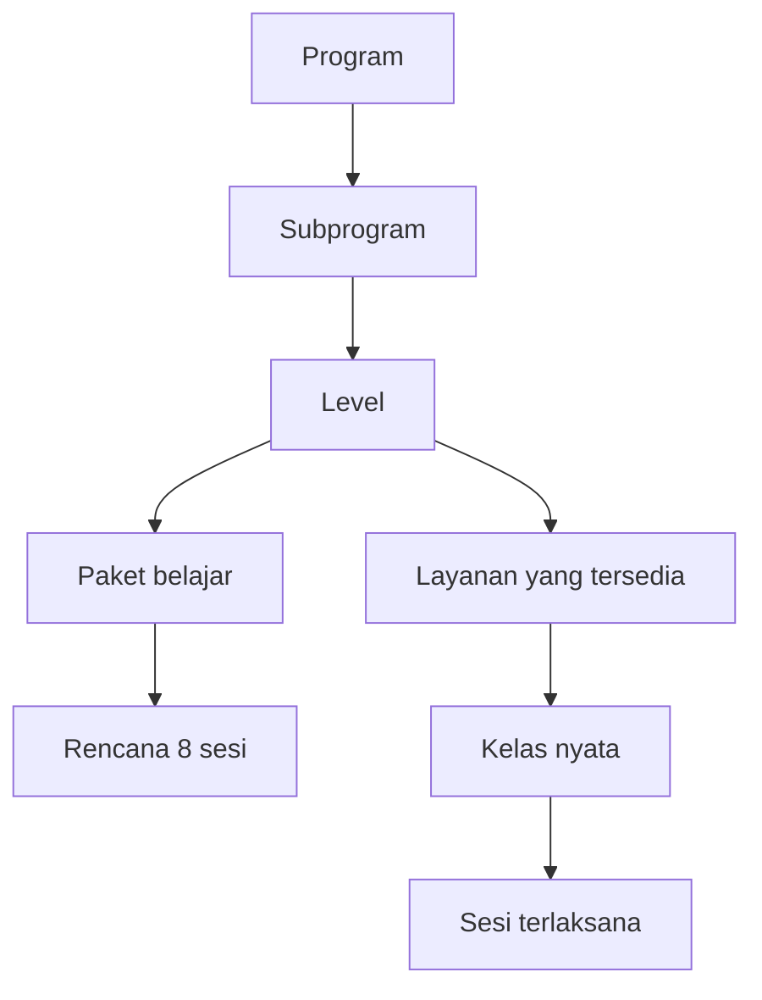

# Business Requirements Document — Tong Yi Group

| Atribut | Nilai |
|---|---|
| Versi | 0.2 — draf acuan pengembangan dengan stack disepakati |
| Tanggal | 26 Oktober 2026 |
| Bahasa | Bahasa Indonesia |
| Dasar | Keputusan dan koreksi pemilik produk dalam pembahasan 25–26 Oktober 2026 yang tersedia |
| Status | Aturan bertanda **Disepakati** menjadi acuan; dokumen secara keseluruhan belum dianggap persetujuan final semua detail |
| Produk | Sistem pengelolaan pembelajaran Tong Yi Group |
| Fokus pekerjaan pertama | Pengelolaan program melalui ruang Admin Tong Yi |

## 1. Cara menggunakan dokumen

Dokumen ini menjadi acuan kebutuhan bisnis sebelum desain database dan implementasi. Prototipe berfungsi untuk mencoba interaksi; isi contoh, susunan kode, dan keterbatasan prototipe **bukan** keputusan bisnis otomatis.

Label yang digunakan:

- **Disepakati**: dinyatakan atau disetujui pemilik produk dalam pembahasan yang tersedia.
- **Rancangan**: penerjemahan kebutuhan menjadi perilaku sistem yang perlu ditinjau saat desain.
- **Terbuka**: keputusan belum tersedia; tidak boleh diisi diam-diam oleh pengembang.
- **Contoh**: angka, nama, level, tempat, atau jadwal ilustrasi, bukan data operasional atau tarif resmi.

Jika ada konflik dengan pembahasan sebelumnya, koreksi pengguna yang paling akhir berlaku. Catat perubahan pada [catatan keputusan](DECISIONS.md). Jika informasi yang dibutuhkan tidak ada, rujuk daftar keputusan terbuka; jangan menyebutnya telah disepakati.

## 2. Latar belakang dan masalah bisnis

Tong Yi membutuhkan satu sistem yang menghubungkan pengaturan akademik, pemeriksaan guru, pembukaan kelas, pendaftaran, pembayaran, pembelajaran, ujian, sertifikat, kelanjutan siswa, dan pencairan penghasilan guru.

Permasalahan yang harus diselesaikan:

1. Banyak program, kelompok peserta, variasi pembelajaran, level, dan jenis layanan perlu dikelola tanpa mengunci seluruh produk pada satu struktur Mandarin atau satu harga.
2. Kualifikasi guru berbeda menurut program dan level; kemampuan serta kesediaan membuka kelas tidak selalu sama.
3. Kelas offline tersebar di berbagai daerah. Kelanjutan tidak dapat mengandalkan guru dari kota lain datang ke tempat guru sebelumnya.
4. Pembayaran harus terhubung dengan hak sesi setiap siswa dan sisa pembayaran yang belum digunakan.
5. Presensi dan dokumentasi harus menjadi bagian sesi yang sama, bukan laporan manual tambahan untuk payroll.
6. Status naik belajar, kelulusan, dan penerbitan sertifikat perlu dibedakan.
7. Penghasilan guru perlu dihitung dari data terintegrasi dan dibayarkan melalui proses klaim yang dapat dipantau.
8. Antarmuka admin harus mudah dipahami walaupun data dan aturan bisnisnya kompleks.

## 3. Tujuan dan ukuran keberhasilan

### 3.1 Tujuan bisnis

- Mengelola banyak program dan subprogram secara fleksibel.
- Menghubungkan seluruh proses dari program hingga klaim tanpa input laporan berulang.
- Menjaga hak belajar siswa dan integritas sertifikat.
- Memungkinkan pengembangan kompetensi guru melalui jalur bukti eksternal maupun pelatihan dan asesmen internal Tong Yi.
- Mendukung pembelajaran online dan offline sesuai layanan yang benar-benar tersedia.
- Menyiapkan operasional yang dapat berkembang lintas daerah.

### 3.2 Ukuran keberhasilan yang dapat diperiksa

| Indikator | Cara memeriksa |
|---|---|
| Fleksibilitas katalog | Admin dapat membuat dua subprogram dengan kombinasi layanan yang berbeda tanpa mengisi layanan yang tidak ditawarkan |
| Keterpisahan konfigurasi | Perubahan paket, kurikulum, kapasitas, atau harga Simplified tidak mengubah Traditional |
| Kelengkapan kurikulum | Jumlah sesi rencana = jumlah paket × 8; setiap sesi memiliki tempat input materi |
| Integrasi sesi dan klaim | Klaim normal tidak tersedia sebelum delapan sesi lengkap |
| Perlindungan pembayaran | Sisa hak siswa terlihat dan tidak hilang saat perubahan kelas |
| Integritas sertifikat | Melanjutkan level atau membayar tidak mengubah hasil kelulusan sebelumnya |
| Ketertelusuran operasional | Perubahan penting dan pencairan memiliki pelaku, waktu, status, serta alasan/bukti yang sesuai |
| Keterpakaian admin | Daftar program langsung tampil sebagai tabel; tambah/ubah melalui halaman penuh; draf dapat dilanjutkan |

Target kuantitatif seperti waktu respons, jumlah pengguna serentak, atau tingkat konversi pelatihan belum ditetapkan.

## 4. Ruang lingkup

### 4.1 Kebutuhan produk yang tercakup

1. Pengelolaan program, subprogram, level, paket, kurikulum, dan layanan.
2. Akun/profil guru, pengajuan kualifikasi, pemeriksaan, serta cakupan izin mengajar.
3. Paket pelatihan guru, asesmen, dan sertifikasi kompetensi internal.
4. Pengajuan/persetujuan kelas dan kesiapan pendaftaran.
5. Data siswa/wali, pendaftaran kelas, hak belajar, konfirmasi lanjut/berhenti, dan pengulangan.
6. Pembayaran manual dengan bukti dan verifikasi.
7. Pelaksanaan sesi, materi/latihan, presensi, dan dokumentasi terintegrasi.
8. Ujian pilihan ganda, penilaian otomatis, remedial, dan sertifikat.
9. Kelanjutan level dan perpindahan layanan dengan persetujuan.
10. Klaim guru per kelas dan pencatatan transfer oleh admin.
11. Notifikasi/pengingat, riwayat, dan pengaturan kebijakan yang diperlukan oleh alur di atas.

Daftar ini adalah cakupan kebutuhan produk, bukan janji semua modul selesai pada tahap pertama.

### 4.2 Di luar implementasi awal yang dibahas

- Transfer bank otomatis atau aplikasi mengirim uang langsung.
- Penilaian otomatis pelafalan, berbicara, atau karangan bebas dengan AI.
- Penerbitan sertifikat HSK resmi oleh sistem Tong Yi.
- Migrasi data dari sumber yang belum diidentifikasi.
- Penetapan otomatis kemampuan guru hanya berdasarkan unggahan atau pembayaran.
- Aplikasi native; implementasi awal menggunakan aplikasi web dengan stack yang disepakati pada bagian 4.4.

### 4.3 Fokus iterasi pertama

Ruang Admin dan pengelolaan program menjadi prioritas pertama. Cakupan iterasi berikutnya mengikuti [panduan pengembangan](IMPLEMENTATION_GUIDE.md).

### 4.4 Stack teknologi — Disepakati

Mengacu pada D-29, aplikasi menggunakan **Laravel + Vue.js + Inertia.js + MySQL**. Laravel menangani sisi server dan aturan bisnis; Vue.js menyediakan antarmuka berbasis komponen; Inertia.js menghubungkan halaman Vue dengan route/controller Laravel; MySQL menyimpan data terstruktur.

Keputusan ini tidak mengubah aturan bisnis atau skenario penerimaan. Versi teknologi, konfigurasi deployment, detail autentikasi, penyimpanan berkas, backup, dan retensi masih perlu ditetapkan sesuai O-22.

## 5. Pemangku kepentingan dan peran

| Peran bisnis | Tanggung jawab |
|---|---|
| Pemilik/pengelola Tong Yi | Menetapkan kebijakan, harga, struktur akademik, dan standar kompetensi |
| Admin akademik | Mengatur program/kurikulum, memeriksa guru, menyetujui kelas, dan menangani hasil akademik sesuai wewenang |
| Admin keuangan | Memverifikasi pembayaran dan memproses pencairan sesuai wewenang |
| Guru | Mengajukan izin/kelas, mengajar, mengisi presensi dan dokumentasi, serta mengajukan klaim |
| Siswa | Memilih kelas, memenuhi pembayaran, belajar, mengikuti ujian, serta memilih kelanjutan |
| Wali | Mewakili atau mendampingi siswa sesuai hubungan dan kewenangan yang tercatat |
| Penilai/pelatih Tong Yi | Menjalankan pemeriksaan kompetensi, pelatihan, dan asesmen sesuai penugasan |

Pembagian admin akademik/keuangan adalah **rancangan pembagian kewenangan**. Satu orang dapat memegang beberapa kewenangan; jumlah jenis akun final dan mekanisme hubungan wali–siswa masih perlu dirinci.

Prinsip akses:

- Admin melihat fungsi sesuai kewenangannya.
- Guru hanya mengelola kelas dan siswa dalam penugasannya; tidak memperoleh kunci ujian karena menjadi pengajar.
- Siswa/wali hanya melihat data belajar dan pembayaran yang menjadi haknya.
- Pengelolaan bank soal dan kunci dibatasi kepada petugas berwenang.
- Antarmuka admin tidak mencampur menu tindakan guru/siswa seolah semua peran sama.

## 6. Istilah dan hubungan data bisnis

| Istilah | Definisi |
|---|---|
| Program | Wadah pembelajaran yang dikelola Tong Yi, misalnya Mandarin |
| Kategori | Pengelompokan program, misalnya Bahasa; kategori lain dapat ditambahkan sesuai kebutuhan |
| Subprogram | Variasi peserta dan pembelajaran di dalam program, misalnya Mandarin Dewasa Simplified |
| Level | Tahap pembelajaran dalam subprogram; nama dan urutan lengkap ditetapkan Tong Yi |
| Paket belajar | Unit normal delapan sesi; satu level dapat memiliki beberapa paket |
| Kurikulum | Rencana materi, tujuan, latihan, dan referensi untuk setiap paket dan sesi |
| Layanan | Bentuk layanan yang benar-benar ditawarkan, misalnya Group Online atau Private Offline |
| Kelas | Pelaksanaan nyata suatu subprogram/level/layanan dengan guru, jadwal, dan lokasi/media tertentu |
| Sesi | Satu pertemuan kelas, beserta presensi dan dokumentasi |
| Hak belajar | Sesi yang telah dibayar dan masih dapat diterima siswa |
| Izin mengajar | Cakupan program/level yang disetujui untuk guru |
| Kelulusan | Hasil akademik level; berbeda dari keputusan untuk lanjut belajar |
| Klaim | Permintaan pencairan penghasilan guru atas paket sesi yang memenuhi syarat |

Penempatan konfigurasi layanan pada subprogram/level adalah **rancangan logis**: admin menambah layanan di dalam subprogram, sementara harga, kapasitas, dan keberlakuannya harus dapat berbeda menurut level. Diagram bukan skema tabel database final.

## 7. Pengelolaan program dan kurikulum

### 7.1 Program, subprogram, dan level — Disepakati

- Satu program dapat berisi beberapa subprogram.
- Subprogram dapat membedakan kelompok peserta, misalnya anak-anak/dewasa, dan variasi seperti Simplified/Traditional.
- Konfigurasi masing-masing variasi harus berdiri sendiri.
- Level, jumlah paket, materi, harga, dan kapasitas dapat berbeda antarsubprogram.
- Jumlah dan nama level tidak dikunci pada daftar contoh dari prototipe.
- Perubahan satu variasi tidak boleh menimpa variasi lain.

**Contoh:** Mandarin Dewasa Simplified Beginner mempunyai tiga paket; Mandarin Dewasa Traditional Beginner boleh memiliki jumlah paket dan kurikulum lain. Angka aktual bukan ditetapkan oleh contoh ini.

### 7.2 Layanan fleksibel — Disepakati

- Admin menambahkan layanan yang memang dibuka di dalam subprogram.
- Sistem tidak mewajibkan seluruh kombinasi Group/Private dan Online/Offline.
- Setiap layanan memiliki pengaturan harga dan kapasitas sesuai kebutuhan.
- Tidak ada layanan Online/Offline yang dianggap tersedia hanya karena kolomnya ada.
- Layanan yang tidak ditawarkan tidak memerlukan isian harga.

**Contoh:** subprogram A hanya menawarkan Group Online; subprogram B hanya menawarkan Private Offline. Keduanya sah dan tidak perlu membuat layanan pengisi.

**Terbuka:** apakah ada jenis layanan lain, variasi kapasitas private/semi-private, durasi berbeda per layanan, serta kapan konfigurasi baru berlaku untuk kelas berjalan.

### 7.3 Paket dan rencana sesi — Disepakati

- Paket normal terdiri dari delapan sesi.
- Jumlah sesi level dihitung dari jumlah paket × 8.
- Kurikulum dipecah berdasarkan paket dan sesi, bukan hanya satu kotak deskripsi seluruh level.
- Admin dapat mengisi materi yang harus diajarkan pada setiap sesi.
- Contoh Beginner: 3 paket = 24 sesi; contoh Advanced: 8 paket = 64 sesi.
- Penyebutan bulan merupakan perkiraan durasi; progres mengikuti sesi aktual dan penggantian jadwal.

**Rancangan isian sesi kurikulum:** judul materi, tujuan belajar, materi wajib, latihan/tugas, dan referensi/bahan ajar. Tema paket dapat merangkum fokus delapan sesi.

**Rancangan perlindungan:** pengurangan jumlah paket tidak menghapus materi tanpa pemberitahuan dan mekanisme yang jelas. Materi tersimpan perlu dipertahankan sampai tindakan penghapusan yang disengaja.

### 7.4 Antarmuka admin — Disepakati

- Menu Program Akademik dibuka sebagai tabel data yang rapi.
- Terdapat tindakan utama Tambah Program dan tindakan Ubah pada data yang dipilih.
- Tambah/ubah program menggunakan halaman penuh, bukan pop-up modal.
- Subprogram dan layanan dapat ditambahkan di dalam pengaturan program.
- Hindari navigasi bertingkat dengan banyak tombol Tambah/Simpan terpisah yang memecah pekerjaan.
- Informasi lengkap tetap harus bisa diatur meskipun navigasi disederhanakan.
- Warna utama bernuansa biru. Logo asli akan digunakan setelah diberikan pemilik produk.
- Bahasa Indonesia harus konsisten, jelas, profesional, dan mudah dipahami.

**Rancangan:** satu penyimpanan program mencakup identitas, subprogram, layanan, serta kurikulum; draf disimpan selama pengisian dan dapat dilanjutkan. Untuk sistem utama, persistensi draf harus ditentukan dengan sengaja; penyimpanan browser dalam prototipe tidak berarti draf sudah tersimpan di server atau lintas perangkat.

## 8. Guru dan pengembangan kompetensi

### 8.1 Pengajuan awal — Disepakati

1. Guru membuat profil dan melampirkan CV/pengalaman serta bukti kemampuan.
2. Guru memilih program dan level yang ingin diajar sesuai kemampuan.
3. Tong Yi memeriksa bukti dan kelayakan.
4. Izin mengajar ditetapkan untuk cakupan yang disetujui.
5. Guru dapat mengajukan kelas dalam cakupan tersebut.

Dokumen wajib, ambang kemampuan, pemeriksa berwenang, serta cara wawancara/demonstrasi belum ditetapkan lengkap.

### 8.2 Dua jalur kualifikasi — Disepakati sebagai arah bisnis

| Jalur | Proses | Hasil |
|---|---|---|
| Bukti yang sudah dimiliki | Guru mengunggah sertifikat relevan; Tong Yi memeriksa kesesuaian | Izin sesuai hasil pemeriksaan |
| Pelatihan internal | Guru mengikuti paket pelatihan berbayar dan asesmen Tong Yi | Jika memenuhi standar: sertifikat kompetensi internal dan izin sesuai persetujuan |

Pemilik produk mengarahkan pelatihan dan asesmen guru sebagai sumber pendapatan utama yang ingin dikembangkan. Besaran pendapatan, harga, dan model paket belum ditetapkan.

Pembayaran pelatihan, penyelesaian pelatihan, kelulusan asesmen, dan pemberian izin merupakan kejadian yang berbeda. Membayar tidak otomatis menghasilkan sertifikat atau izin. Sertifikat internal memakai identitas Tong Yi dan tidak disebut sertifikat HSK resmi.

### 8.3 Penambahan level — Disepakati

- Guru dapat mengajukan perluasan izin sebelum level kelas saat ini selesai.
- Sistem mencatat pengajuan, bukti, hasil pemeriksaan, alasan, dan cakupan yang disetujui.
- Siswa naik level tidak otomatis membuat guru berwenang mengajar level berikutnya.
- Kemampuan mengajar tidak mewajibkan guru membuka seluruh level yang diizinkan.

**Rancangan status:** Diajukan, Diperiksa, Perlu Dilengkapi, Disetujui, Ditolak. Standar penilaian dan prosedur asesmen ulang masih terbuka.

## 9. Kelas dan kelanjutan offline/online

### 9.1 Pembukaan kelas — Rancangan alur

1. Guru yang memperoleh izin memilih program/subprogram, level, dan layanan yang tersedia.
2. Guru mengajukan jadwal, kapasitas sesuai kebijakan, serta lokasi offline atau media online.
3. Admin memeriksa kesiapan dan cakupan izin.
4. Setelah disetujui, kelas dibuka untuk pendaftaran.
5. Siswa/wali melihat guru, lokasi/media, jadwal, serta biaya sebelum menyetujui.

Jumlah minimum/maksimum harus dapat diatur. Perilaku kelas di bawah minimum, daftar tunggu, pemerataan penempatan, dan kuota aman belum terurai cukup untuk dijadikan algoritma final.

### 9.2 Kelanjutan dengan guru sama — Disepakati

Jika guru berwenang dan bersedia, guru dapat mengajukan kelas level berikutnya. Jadwal, lokasi, dan kelompok dapat diusulkan tetap sama; riwayat level lama tetap disimpan.

### 9.3 Guru tidak membuka level berikutnya — Disepakati

- Guru boleh tidak melanjutkan ke level berikutnya, walaupun memiliki kemampuan.
- Kewajiban kelas berjalan yang sudah dibayar tetap diselesaikan.
- Admin/sistem menawarkan kelas lain yang cocok menurut daerah, program, level, jadwal, progres, kapasitas, dan layanan.
- Untuk offline, siswa dapat memilih lokasi berbeda setelah melihat detail dan menyetujui.
- Tidak ada pemindahan otomatis guru atau siswa ke lokasi lain.
- Mendatangkan guru lintas kota ke lokasi guru lama bukan solusi standar rancangan.
- Jika belum tersedia pilihan cocok, siswa dapat menunggu atau memilih online jika bersedia; ketersediaan tidak boleh dijanjikan sebelum pasti.

Usulan mengumpulkan minat sekelompok teman untuk kelas lanjutan belum ditetapkan mekanismenya.

## 10. Pendaftaran, pembayaran, dan hak belajar siswa

### 10.1 Pembayaran manual — Disepakati

- Siswa/wali membayar dan memberikan bukti sesuai proses lembaga.
- Admin berwenang memverifikasi pembayaran.
- Hak mengikuti sesi dihubungkan dengan pembayaran yang telah terverifikasi.
- Sistem mencatat program/level, paket atau rentang sesi, nominal, status, bukti, dan sisa hak belajar.
- Angka tarif prototipe/contoh bukan tarif resmi.

### 10.2 Konfirmasi sebelum paket habis — Disepakati; menggantikan usulan tunggu satu minggu

Contoh jadwal Kamis–Sabtu:

| Waktu | Perilaku |
|---|---|
| Sabtu, sesi ke-6 selesai | Mulai konfirmasi lanjut/berhenti dan pembayaran paket berikutnya |
| Kamis berikutnya, sesi ke-7 | Batas konfirmasi serta pembayaran berikutnya pada contoh tersebut |
| Sabtu berikutnya, sesi ke-8 | Sesi terakhir yang sudah dibayar tetap diberikan |
| Sesi ke-9 | Hanya boleh diikuti jika pembayaran berikutnya telah terverifikasi |

Tidak membayar paket berikutnya tidak mencabut hak sesi ke-7/ke-8 yang sudah dibayar. Jika siswa menyatakan berhenti, kursi baru tersedia untuk pengganti setelah hak paket berjalan selesai.

**Terbuka:** rumus penentuan batas konfirmasi pada seluruh pola jadwal, batas waktu verifikasi manual, kasus transfer tepat waktu tetapi admin terlambat memeriksa, serta pelepasan kursi siswa tanpa respons.

### 10.3 Belum membayar tetapi datang offline — Disepakati

Siswa yang belum berhak mengikuti sesi berikutnya tidak boleh ikut hanya karena hadir di lokasi. Daftar sesi menunjukkan status hak belajarnya; guru memeriksa dan menegakkan aturan. Pelaksanaan akses online disesuaikan dengan status yang sama.

### 10.4 Pembayaran beberapa paket — Disepakati prinsip perlindungannya

- Seluruh sesi yang sudah dibayar tetap menjadi hak siswa.
- Bayar penuh level 24 sesi berarti lembaga berkewajiban menyediakan 24 sesi, bukan hanya delapan.
- Guru tidak membuka level selanjutnya tidak menghapus kewajiban menyelesaikan level berjalan.
- Perubahan kelas/guru tidak boleh membuat siswa membayar ulang sesi yang sudah dibayar.
- Dana untuk sesi yang belum diberikan tidak dianggap sebagai penghasilan guru yang sudah layak dicairkan.

**Usulan belum dikonfirmasi sebagai prosedur final:** membatasi pembayaran banyak paket pada level aktif, membuka pembayaran level berikutnya hanya setelah kelas tersedia, serta pengembalian sisa pembayaran ketika lembaga tidak dapat memenuhi layanan dan tidak ada pengganti yang disetujui. Prinsip hak siswa tetap berlaku; prosedur rinci menunggu keputusan.

## 11. Pelaksanaan sesi dan presensi

**Disepakati:**

1. Materi dan latihan dapat disiapkan sebelum kelas.
2. Guru membuka sesi melalui sistem.
3. Guru mengisi status kehadiran siswa.
4. Guru melengkapi dokumentasi wajib pada sesi tersebut.
5. Sesi diselesaikan setelah isian wajib lengkap.
6. Data yang sama dipakai untuk monitoring dan kelayakan klaim.

Tidak ada laporan presensi manual terpisah yang harus diketik atau diunggah kembali untuk payroll. Jika presensi/dokumentasi belum lengkap, sesi belum selesai dan belum dihitung sebagai sesi lengkap untuk klaim.

**Terbuka:** bentuk dokumentasi wajib, siapa yang dapat mengoreksi sesi selesai, tenggat melengkapi isian, penanganan sesi tertunda/berulang, pembatalan, dan kebijakan ketidakhadiran atau penggantian siswa. Hak sesi saat siswa absen tidak boleh disimpulkan tanpa kebijakan.

## 12. Ujian, remedial, pengulangan, dan sertifikat

### 12.1 Ujian awal — Disepakati

- Ujian akhir versi awal berupa pilihan ganda di aplikasi.
- Petugas berwenang mengelola soal, kunci, dan aturan kelulusan.
- Jawaban diperiksa serta nilainya dihitung otomatis oleh sistem.
- PDF saja bukan ujian terstruktur yang otomatis dinilai.
- Guru tidak otomatis memperoleh akses bank soal atau kunci ujian resmi.
- Bobot komponen selain ujian dan ambang nilai final belum ditentukan.

### 12.2 Siswa belum lulus — Disepakati

Siswa boleh memilih lanjut level berikutnya dengan memahami risiko, mengikuti remedial, atau mengulang level. Kesempatan belajar tidak ditutup hanya karena satu ujian belum tuntas.

Keputusan lanjut tidak mengubah hasil level sebelumnya menjadi lulus. Jika siswa lulus level berikutnya, sertifikat level sebelumnya tidak otomatis terbit.

### 12.3 Remedial — Disepakati sebagian

Remedial pertama gratis satu kali. Jumlah kesempatan, biaya kesempatan berikutnya, jadwal, dan aturan penggabungan nilai belum ditetapkan.

### 12.4 Pengulangan — Disepakati

Siswa menggunakan akun/profil yang sama, memilih kelas pengulangan yang tersedia, lalu membayar sesuai ketentuan. Tidak mengisi biodata/registrasi akun dari awal. Riwayat upaya sebelumnya dipertahankan. Diskon atau harga khusus belum ditentukan.

### 12.5 Sertifikat — Disepakati

- Sertifikat tidak bisa dibeli.
- Penerbitan mengikuti kelulusan dan persyaratan level terkait.
- Pembayaran, ikut kelas, atau lanjut level bukan bukti kelulusan otomatis.
- Sertifikat internal kompetensi guru berbeda dari sertifikat siswa dan berbeda dari HSK resmi.

Template, penandatangan, nomor, validasi publik, dan rincian syarat penerbitan belum ditetapkan.

## 13. Perpindahan kelas dan layanan

**Disepakati:** perpindahan biasa memakai layanan dan harga sama; perubahan layanan/harga ditangani admin. Sisa pembayaran diperhitungkan dan siswa/wali menyetujui detail tujuan serta penyesuaian sebelum perpindahan.

**Rancangan pemeriksaan kecocokan:** program/subprogram, kurikulum, level, progres, jadwal, kuota, daerah, serta kebutuhan peserta.

**Contoh perhitungan, bukan tarif resmi:** sisa pembayaran Rp800.000 dan biaya layanan tujuan untuk sisa sesi Rp1.600.000 menghasilkan kekurangan Rp800.000. Nilai lebih atau kekurangan tidak menentukan prosedur refund secara otomatis.

Terbuka: tarif per sesi, prorata, paket yang sebagian digunakan, diskon, perubahan harga, pengulangan, penyelarasan progres, dan otorisasi penyesuaian.

## 14. Penghasilan guru dan klaim

### 14.1 Syarat — Disepakati

- Klaim normal per kelas setelah delapan sesi lengkap.
- Presensi dan dokumentasi wajib sudah lengkap melalui sistem.
- Guru tidak membuat laporan manual atau menghitung ulang nominal.
- Sistem menghitung dari data sesi dan perjanjian yang tersimpan.
- Sesi/paket yang sudah diklaim tidak dapat diklaim dua kali.
- Guru mengajukan klaim; admin melakukan transfer dan mencatat buktinya.
- Pencairan tidak menunggu seluruh level selesai jika satu paket sudah memenuhi syarat.

Persentase 70% guru/30% lembaga pernah disebut oleh asisten sebagai rujukan terdahulu, tetapi tidak tersedia konfirmasi langsung pengguna dalam konteks ini. **Jangan jadikan angka tersebut default resmi.** Nilai perjanjian perlu dipastikan.

### 14.2 Rancangan status

| Status | Makna |
|---|---|
| Belum memenuhi syarat | Delapan sesi atau kelengkapannya belum terpenuhi |
| Siap diklaim | Syarat terpenuhi dan rincian tersedia |
| Diajukan | Guru mengajukan klaim |
| Diproses | Admin memeriksa/melakukan pembayaran |
| Perlu perbaikan | Masalah dan alasan diberikan untuk ditindaklanjuti |
| Dibayarkan | Transfer dilakukan dan bukti/nominal/waktu tercatat |

### 14.3 Batas pencairan — Disepakati

Klaim lengkap yang diajukan hari ini dibayarkan maksimal pada hari operasional berikutnya. Minggu dan tanggal merah dikecualikan; Sabtu dihitung.

| Contoh hari pengajuan | Batas tanpa libur tambahan |
|---|---|
| Senin | Selasa |
| Jumat | Sabtu |
| Sabtu | Senin |
| Minggu | Senin |

Tanggal batas dan status terlihat. Lewat batas waktu tidak otomatis membuat status Dibayarkan. Kalender libur harus dikelola dengan benar; sumber tanggal merah dan jam batas pengajuan belum ditetapkan.

## 15. Kebutuhan fungsional dan prioritas

Prioritas berikut adalah **usulan urutan implementasi**, bukan pengurangan kebutuhan bisnis.

| ID | Kebutuhan | Prioritas |
|---|---|---|
| FR-01 | Akun/peran dan pembatasan akses Admin, Guru, Siswa/Wali | Fondasi |
| FR-02 | Tabel program, tambah/ubah halaman penuh, bahasa dan navigasi konsisten | Tahap 1 |
| FR-03 | Program dengan beberapa subprogram dan level yang independen | Tahap 1 |
| FR-04 | Layanan opsional dengan metode, harga, minimum/maksimum masing-masing | Tahap 1 |
| FR-05 | Jumlah paket dan kurikulum delapan sesi per paket | Tahap 1 |
| FR-06 | Draf program dapat disimpan/dilanjutkan tanpa tercampur data terbit | Tahap 1 |
| FR-07 | Profil, CV, dan bukti kemampuan guru | Tahap 2 |
| FR-08 | Pengajuan/pemeriksaan/perluasan izin mengajar | Tahap 2 |
| FR-09 | Pelatihan berbayar, asesmen, dan hasil kompetensi internal | Tahap 2 |
| FR-10 | Kemampuan guru terpisah dari kesediaan membuka kelas | Tahap 2 |
| FR-11 | Pengajuan kelas berdasarkan izin dan layanan tersedia | Tahap 3 |
| FR-12 | Persetujuan kelas, lokasi/media, jadwal, kapasitas | Tahap 3 |
| FR-13 | Pendaftaran siswa menggunakan data profil yang tersimpan | Tahap 3 |
| FR-14 | Pembayaran manual, bukti, verifikasi, serta pemetaan hak sesi | Tahap 4 |
| FR-15 | Pengingat/konfirmasi lanjut sebelum paket habis | Tahap 4 |
| FR-16 | Penandaan/pembatasan akses siswa tanpa hak sesi | Tahap 4 |
| FR-17 | Pemantauan sisa pembayaran dan hak belajar | Tahap 4 |
| FR-18 | Buka sesi, presensi, dokumentasi, selesai dalam satu proses | Tahap 5 |
| FR-19 | Materi dan latihan disiapkan sebelum sesi | Tahap 5 |
| FR-20 | Bank soal/kunci untuk petugas berwenang dan ujian terstruktur | Tahap 6 |
| FR-21 | Penilaian pilihan ganda otomatis serta aturan kelulusan | Tahap 6 |
| FR-22 | Remedial gratis pertama, riwayat upaya, dan pengulangan | Tahap 6 |
| FR-23 | Sertifikat berdasarkan hasil level; lanjut bukan otomatis lulus | Tahap 6 |
| FR-24 | Penawaran kelas lanjutan dan persetujuan perubahan | Tahap 6 |
| FR-25 | Perpindahan dengan pemeriksaan sisa hak/selisih layanan | Tahap 6 |
| FR-26 | Klaim per kelas setiap delapan sesi lengkap | Tahap 7 |
| FR-27 | Perhitungan perjanjian, pencegahan klaim ganda, status pencairan | Tahap 7 |
| FR-28 | Bukti transfer, batas hari operasional, dan kalender libur | Tahap 7 |
| FR-29 | Riwayat tindakan penting dan perubahan kebijakan | Lintas tahap |
| FR-30 | Pengaturan kebijakan yang belum final tidak diberi angka resmi diam-diam | Lintas tahap |

## 16. Kebutuhan nonfungsional — Rancangan

| Area | Kebutuhan |
|---|---|
| Integritas | Nilai, pembayaran, hak sesi, dan klaim harus konsisten; tindakan duplikat tidak menghasilkan hak/klaim ganda |
| Keamanan akses | Pemeriksaan otorisasi di server, bukan hanya menyembunyikan tombol |
| Kerahasiaan | Bukti transfer, CV/sertifikat, dokumentasi siswa, dan kunci ujian hanya diakses sesuai kewenangan |
| Audit | Perubahan penting mencatat pelaku, waktu, alasan, dan hubungan transaksi |
| Ketahanan data | Mekanisme backup, pemulihan, penyimpanan berkas, serta penanganan kegagalan ditentukan sebelum produksi |
| Usabilitas | Tabel jelas, formulir terstruktur, pesan validasi mudah dipahami, fokus pekerjaan tidak tercampur antarperan |
| Aksesibilitas | Label formulir, navigasi keyboard, kontras, dan status tindakan terbaca |
| Responsivitas | Admin nyaman di desktop, tetap dapat digunakan pada layar kecil; tabel panjang ditangani dengan baik |
| Waktu | Penyimpanan waktu konsisten dengan zona operasional; kalender libur dan batas pencairan eksplisit |
| Perubahan konfigurasi | Harga/kurikulum yang berubah tidak boleh diam-diam merusak transaksi dan riwayat kelas lama |

Target performa, SLA aplikasi, retensi berkas, lokasi data, dan kebijakan privasi operasional masih terbuka. Tidak ada klaim kepatuhan hukum atau sertifikasi tertentu melalui dokumen ini.

## 17. Kelompok data konseptual

Bukan ERD final; nama tabel dan skema relasional belum ditentukan. Basis data yang digunakan adalah MySQL sesuai D-29.

| Kelompok | Data utama |
|---|---|
| Identitas | Akun, profil, kewenangan, hubungan wali–siswa |
| Akademik | Program, subprogram, level, versi kurikulum, paket, rencana sesi |
| Layanan | Jenis/metode, kapasitas, harga dan keberlakuannya |
| Guru | Pengajuan, dokumen, pemeriksa, izin, kesediaan, pelatihan, asesmen |
| Operasional | Kelas, guru yang ditugaskan, jadwal, lokasi/media, pendaftaran |
| Pembelajaran | Sesi aktual, materi, presensi, dokumentasi |
| Pembayaran | Tagihan/paket, bukti, verifikasi, hak sesi, sisa nilai |
| Evaluasi | Soal, opsi/kunci, ujian, jawaban, nilai, remedial, kelulusan, sertifikat |
| Kelanjutan | Minat lanjut, tawaran kelas, persetujuan perubahan, perpindahan |
| Penghasilan | Perjanjian, rincian hak penghasilan, klaim, bukti transfer |
| Kontrol | Kalender, pengaturan, notifikasi, audit, draf |

Rancangan teknis perlu menjawab transaksi atomik, versi harga/kurikulum, hak akses berkas, serta koreksi data yang sudah dipakai untuk klaim. Penyimpanan browser prototipe bukan model penyimpanan produksi.

## 18. Skenario penerimaan

| ID | Kondisi dan tindakan | Hasil yang harus diperiksa |
|---|---|---|
| AC-01 | Admin membuka Program Akademik | Tabel data tampil; formulir tambah belum terbuka |
| AC-02 | Admin memilih Tambah Program | Halaman penuh, bukan modal; tersedia subprogram dan layanan opsional |
| AC-03 | Subprogram hanya menawarkan Group Online | Dapat disimpan tanpa harga/layanan Offline |
| AC-04 | Subprogram lain hanya menawarkan Private Offline | Tidak diwajibkan Group atau Online |
| AC-05 | Harga/paket Simplified diubah | Traditional tidak ikut berubah |
| AC-06 | Level berisi tiga paket | Tersedia 24 rencana sesi, delapan pada tiap paket |
| AC-07 | Admin mengisi materi sesi tertentu | Materi, tujuan, latihan, dan referensi terkait ke sesi/paket yang benar |
| AC-08 | Admin kembali ke daftar saat mengisi | Draf dapat dilanjutkan sesuai desain persistensi; bukan program terbit otomatis |
| AC-09 | Maksimum peserta lebih kecil dari minimum | Validasi menjelaskan masalah dan mencegah penyimpanan data tidak valid |
| AC-10 | Guru mengajukan level di luar izinnya | Harus melalui pemeriksaan/perluasan, tidak otomatis diizinkan |
| AC-11 | Guru membayar pelatihan tetapi belum lulus | Tidak otomatis mendapat sertifikat kompetensi atau izin |
| AC-12 | Guru berizin tetapi tidak ingin membuka lanjutan | Dapat menyatakan tidak bersedia; siswa ditawarkan alternatif yang tersedia |
| AC-13 | Paket lama dibayar, paket berikutnya belum | Hak sesi ke-7/ke-8 tetap ada; sesi ke-9 dibatasi sesuai verifikasi |
| AC-14 | Siswa tanpa hak sesi datang offline | Kehadiran fisik tidak mengaktifkan hak mengikuti kelas |
| AC-15 | Presensi atau dokumentasi belum lengkap | Sesi belum selesai dan belum membuka klaim |
| AC-16 | Delapan sesi kelas lengkap | Klaim tersedia tanpa laporan presensi manual tambahan |
| AC-17 | Klaim yang sama diajukan kembali | Tidak terbentuk pencairan ganda |
| AC-18 | Klaim diajukan Sabtu; Senin bukan libur | Batas pencairan Senin |
| AC-19 | Hari operasional berikutnya tanggal merah | Batas bergeser ke hari operasional berikutnya yang tidak libur |
| AC-20 | Tenggat lewat tetapi belum transfer | Status belum Dibayarkan |
| AC-21 | Siswa belum lulus memilih lanjut | Status sebelumnya tetap belum tuntas dan sertifikatnya belum terbit |
| AC-22 | Remedial pertama dipilih | Dicatat gratis satu kali; riwayat upaya tetap ada |
| AC-23 | Siswa mengulang | Profil dipakai kembali; pembayaran dan kelas pengulangan tetap diperlukan |
| AC-24 | Lokasi/jadwal kelas lanjutan berubah | Persetujuan siswa/wali diperlukan sebelum pemindahan |
| AC-25 | Siswa membayar 24 sesi; guru tidak membuka level berikutnya | Seluruh hak level berjalan tetap harus dipenuhi |
| AC-26 | Pembayaran dan penghasilan dihitung | Bagian guru mengikuti perjanjian yang benar-benar ditetapkan, bukan angka contoh |

Skenario refund, absensi, kuota minimum, penempatan, dan beberapa pengecualian diuji setelah keputusan terbukanya diselesaikan. Jangan menulis tes yang mengubah dugaan menjadi kebijakan.

## 19. Dependensi, risiko, dan keputusan lanjutan

- Standar guru dan penguji harus disiapkan agar izin bukan persetujuan administratif semata.
- Keberlanjutan offline bergantung pada guru/lokasi yang benar-benar tersedia di daerah siswa.
- Verifikasi manual membutuhkan petugas dan jam layanan yang jelas.
- Kurikulum perlu diisi oleh pihak akademik, bukan dihasilkan asal oleh sistem.
- Data pembayaran/sesi harus stabil sebelum payroll dipakai sungguhan.
- Pelatihan sebagai model pendapatan membutuhkan paket, standar kelulusan, dan proses operasional yang belum dirinci.
- Banyaknya opsi tidak boleh membuat antarmuka penuh tombol; kompleksitas data ditangani melalui pengelompokan di halaman kerja yang sama.

Daftar keputusan lengkap yang masih terbuka berada pada [DECISIONS.md](DECISIONS.md). BRD ditinjau kembali saat keputusan baru dibuat. Pengembangan dimulai dari satu alur lengkap dan dapat diuji, lalu diperluas bertahap.
